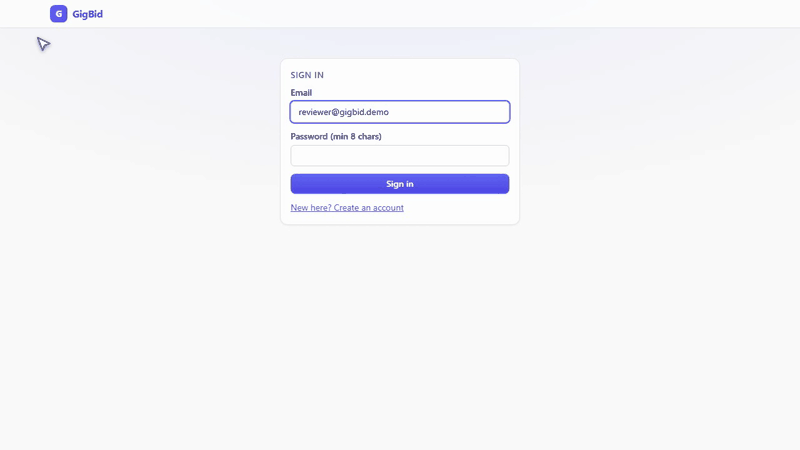

# GigBid: a multi-agent freelancer copilot

**Abdul Basit · Roll No. 23i-0820 · Section Agentic C** · AI-4016 Assignment II

> AI-4016 Assignment II (FAST-NUCES). A team of LangGraph agents finds freelance jobs, judges whether they are worth bidding on, writes proposals **in which every claim is checked against portfolio evidence**, and manages client conversations. A human approves every proposal and message before anything leaves the system.



*(30-second walkthrough; full 3-minute video linked in the table below.)*

| | |
|---|---|
| Live app | https://chicly-unhesitative-jamila.ngrok-free.dev (served from my laptop through an ngrok tunnel; open it, click through ngrok's one-time "Visit Site" notice; reviewer login is in the Google Classroom private comment) |
| Demo video (3 min) | https://youtu.be/FuSiqrwNs_8 |
| Portfolio MCP server | [`mcp_servers/portfolio`](mcp_servers/portfolio/README.md) (run with `uv run python -m mcp_servers.portfolio.server`; PyPI publishing not done) |
| Technical write-up | [https://dev.to/abdul_basit_863d2936a69df/the-retriever-with-the-best-score-wrote-the-worst-proposals-and-other-things-my-ablations-told-me-20ne](https://dev.to/abdul_basit_863d2936a69df/the-retriever-with-the-best-score-wrote-the-worst-proposals-and-other-things-my-ablations-told-me-20ne) (source text: [`docs/WRITEUP_DRAFT.md`](docs/WRITEUP_DRAFT.md)) |
| Traces | [`docs/TRACES.md`](docs/TRACES.md) (how to open a scam skip, an approved proposal, a critic loop, a crash-and-resume) |

## What it does (60 seconds)
1. Scout pulls jobs from saved searches on a schedule and de-duplicates them.
2. **Job Analyst, Risk Assessor and Fit Matcher run in parallel** (LangGraph `Send`): typed `JobSpec`, scam/injection flags, requirement-to-evidence matrix.
3. A decision node picks skip / watch / bid; Pricing proposes a bid and decides if the Connects are worth it.
4. Writer drafts with `[E#]` citations; **claim verification removes unsupported claims**; Critic loops at most twice; Compliance Guard enforces the policy pack.
5. The graph **interrupts**; the UI shows the draft, evidence behind each claim (on hover), risk, price rationale and a `dry_run` preview. Approve / edit (diffed, re-checked, fed to style memory) / reject with a reason. Only then does the executor submit, **exactly once**.
6. Client replies go through a second graph: intent, reply, interview slots, approval.

Architecture, why each agent exists, state vs trace vs memory: [`docs/ARCHITECTURE.md`](docs/ARCHITECTURE.md). Tools: [`docs/TOOLS.md`](docs/TOOLS.md). Safety: [`docs/SAFETY.md`](docs/SAFETY.md).

## Quick start
```bash
make install && cp .env.example .env          # add DEEPSEEK_API_KEY (open profile = DeepSeek hosted open-weight models)
REVIEWER_PASSWORD='choose-one' make demo      # API :8000, login reviewer@gigbid.demo
cd apps/web && npm install && NEXT_PUBLIC_API_URL=http://localhost:8000 npm run dev
make test      # 24+ tests, offline, no key needed
make eval      # LLM-free evals -> evals/results/*.json ; docs/RESULTS.md regenerates with: python -m evals.runners.make_tables
```
`docker compose -f infra/docker-compose.yml up --build` is provided but **untested here** (see Status). Pinned stack: Python 3.11, langgraph 1.2.20, langchain-mcp-adapters 0.3.2, mcp 1.30.0, fastapi 0.162, fastembed 0.9 (BAAI/bge-small-en-v1.5 + Xenova/ms-marco-MiniLM-L-6-v2, both CPU), qdrant-client 1.20 (embedded), Next.js (see `apps/web/package.json`).

## Models
`open` profile (required, default): DeepSeek `deepseek-flash` through its OpenAI-compatible API (hosted open-weight model provider); `open_reasoner`: `deepseek-v4-pro` for Writer/Critic; `offline`: rule-based nodes (no API, used by CI and as the per-node fallback model). Per-node models live in `agent/config.yaml`. Embeddings and reranker are open models on CPU in every profile. No local-GPU run was done (hardware/tokens-per-second columns do not apply).

**Fully local (no API key, no cost):** profile `local_qwen` runs Qwen3.5-4B through Ollama (`ollama pull qwen3.5:4b`, `OLLAMA_CONTEXT_LENGTH=8192`, then `MODEL_PROFILE=local_qwen`). Evaluated on an RTX 3070 Laptop 8 GB: results in `evals/results/*_local_qwen*.json` and report section 11. Honest limits: p95 latency (445 s) misses the 60 s budget on a laptop GPU; the single-agent vs supervisor vs graph comparison there uses 16 jobs; the small model is injectable without the input defence (attack success 0.353 -> 0.042 with it). Resume notes: `docs/PROGRESS.md`.

## Results
Every number below is generated from `evals/results/*.json` by `evals/runners/make_tables.py` (CI fails if stale). **Read [`docs/DATA_CARD.md`](docs/DATA_CARD.md) first: data, gold labels and the simulated client are synthetic and generated by me, so absolute numbers are optimistic.**

<!-- RESULTS:START -->
#### B5. RAG variants (dev set, 60 non-scam jobs per persona = 180)

| Variant | Recall@5 | MRR | nDCG@10 | Recall@5 (>=4 reqs) | p95 latency (s) | GigSim reply rate (letter from top-5 items) |
|---|---|---|---|---|---|---|
| v0 | 0.528 | 0.801 | 0.418 | 0.475 | 0.002 | 0.200 |
| v1 | 0.821 | 0.867 | 0.671 | 0.722 | 0.004 | 0.083 |
| v2 | 0.418 | 0.777 | 0.344 | 0.385 | 0.006 | 0.189 |
| v3 | 0.714 | 0.894 | 0.562 | 0.640 | 3.795 | 0.383 |
| v4 | 0.458 | 0.737 | 0.362 | 0.433 | 0.004 | 0.100 |
| v5 | 0.716 | 0.847 | 0.734 | 0.651 | 0.004 | 0.717 |
| v6 | 0.333 | 0.748 | 0.294 | 0.325 | 0.004 | n/a |
| v7 | 0.734 | 0.875 | 0.571 | 0.688 | 6.434 | n/a |
| v8 | 0.802 | 1.000 | 0.668 | 0.745 | 1.182 | 0.006 |
| v_best | 0.947 | 0.994 | 0.809 | 0.911 | 2.547 | 0.011 |
| shipped_per_requirement | - | - | - | - | - | 0.739 |
| generic_baseline | - | - | - | - | - | 0.422 |

By persona (Recall@5 / nDCG@10):

| Variant | ml | web | data |
|---|---|---|---|
| v0 | 0.500 / 0.426 | 0.569 / 0.427 | 0.515 / 0.402 |
| v1 | 0.839 / 0.722 | 0.789 / 0.638 | 0.834 / 0.654 |
| v2 | 0.396 / 0.348 | 0.424 / 0.338 | 0.434 / 0.347 |
| v3 | 0.691 / 0.580 | 0.744 / 0.568 | 0.707 / 0.539 |
| v4 | 0.483 / 0.393 | 0.436 / 0.340 | 0.456 / 0.355 |
| v5 | 0.657 / 0.705 | 0.710 / 0.719 | 0.779 / 0.778 |
| v6 | 0.284 / 0.273 | 0.391 / 0.323 | 0.325 / 0.285 |
| v7 | 0.738 / 0.614 | 0.760 / 0.576 | 0.703 / 0.524 |
| v8 | 0.766 / 0.656 | 0.833 / 0.680 | 0.807 / 0.667 |
| v_best | 0.926 / 0.822 | 0.951 / 0.802 | 0.962 / 0.803 |

#### Ablation of the shipped pipeline (one component at a time)

| Config | Recall@5 | nDCG@10 | Recall@5 (>=4 reqs) | p95 latency (s) |
|---|---|---|---|---|
| shipped (decompose+hybrid+outcome) | 0.947 | 0.809 | 0.911 | 0.435 |
| +rerank_for_ranking | 0.905 | 0.763 | 0.844 | 0.366 |
| -decomposition | 0.456 | 0.360 | 0.418 | 0.151 |
| -hybrid(BM25) | 0.906 | 0.764 | 0.861 | 0.350 |
| -outcome_boost | 0.932 | 0.768 | 0.890 | 0.399 |

#### Decisions (dev set, 200 jobs per persona, LLM-free triage path)

| Persona | bid/skip F1 | scam P | scam R | price in band | injection flagged |
|---|---|---|---|---|---|
| ml | 0.996 | 1.000 | 1.000 | 1.000 | 1.000 |
| web | 0.992 | 1.000 | 1.000 | 1.000 | 1.000 |
| data | 1.000 | 1.000 | 1.000 | 1.000 | 1.000 |
| **all** | 0.996 | 1.000 | 1.000 | 1.000 | 1.000 |

Before the low-budget scam rule (failure-analysis fix): scam recall 0.811, bid/skip F1 0.976.

#### Open-model configurations (full bid graph to approval; 8 good + 2 scam jobs per persona = 30 jobs)

| Config | drafted | unsupported/proposal before -> after verification | critic loops | judge (1-5) | GigSim reply | p50 / p95 latency (s) | tokens/job | USD/proposal |
|---|---|---|---|---|---|---|---|---|
| open_flash | 24 | 1.542 -> 0.083 | 0.417 | n/a (n=None) | 0.450 (n=20) | 16.230 / 37.430 | 3525 | 0.0029 |
| open_v4pro | 24 | 0.958 -> 0.000 | 1.583 | n/a (n=None) | 0.500 (n=18) | 99.950 / 120.660 | 8763 | 0.0169 |

USD uses placeholder prices in agent/config.yaml (verify against the provider's price list before citing).

#### R&D A: tool granularity (40 tasks, model deepseek-flash)

| Design | #tools | tool-selection acc | argument acc | tokens/task |
|---|---|---|---|---|
| fine | 24 | 0.925 | 0.900 | 1480 |
| coarse | 3 | 1.000 | 0.800 | 579 |
| best_terse | 12 | 0.950 | 0.875 | 958 |
| best_rewritten | 12 | 1.000 | 0.950 | 1190 |

#### R&D C: single agent vs supervisor vs hand-built graph (48 dev jobs: good/weak/scam/injection mix)

| System | bid/skip acc | scams wrongly bid | ungrounded skill claims/proposal | violations in final text | GigSim reply | tokens/job | USD/job | p95 latency (s) |
|---|---|---|---|---|---|---|---|---|
| single_react | 0.958 | 0 | 0.179 | 0.036 | 0.464 (n=28) | 14846 | 0.0046 | 32.833 |
| supervisor | 0.780 | 0 | 0.630 | 0.000 | 0.556 (n=27) | 10110 | 0.0040 | 50.844 |
| gigbid_graph | 1.000 | 0 | 0.000 | 0.000 | 0.533 (n=30) | 922 | 0.0005 | 33.490 |

By job kind (bid/skip accuracy): single_react: good 0.958, weak 1.0, scam 1.0, injection 0.833; supervisor: good 0.909, weak 0.375, scam 1.0, injection 0.5; gigbid_graph: good 1.0, weak 1.0, scam 1.0, injection 1.0

#### E4: prompt-injection attack success rate (36 planted-injection jobs)

| Defences | drafted | ASR |
|---|---|---|
| none | 33 | 0.000 |
| input | 35 | 0.000 |
| input+output | 35 | 0.000 |

#### X2: proposal A/B experiment in GigSim

A = evidence-grounded, per-requirement retrieval (as shipped), cited projects; B = generic skills list; n=180 paired jobs.

Reply rate A 0.739 vs B 0.422; Fisher exact p=1.57e-09; paired exact McNemar p=2.08e-08. simulated clients reward skill mentions and penalise generic phrasing by construction (see DATA_CARD)

#### Judge calibration
Cohen's kappa (binary good>=4): 0.791; quadratic-weighted: 0.859; n=30.
<!-- RESULTS:END -->

### What I would ship, and what surprised me
See `docs/WRITEUP_DRAFT.md` and the report. Short version: requirement decomposition is the component that matters (Recall@5 roughly halves without it); plain hybrid retrieval over the whole job post is *worse* than the dense baseline; the cross-encoder hurt ranking but is the best evidence-gate; a hand-built graph beat a single ReAct agent and a prebuilt supervisor on decision accuracy and grounding, while the single agent was competitive on simulated reply rate and cheaper to build.

## Status: what is and is not done (honest)
| Done and tested | Not done / not verified |
|---|---|
| 3 MCP servers with schemas, annotations, idempotency, dry_run, audit log, tests, schema snapshot | Live Upwork adapter/OAuth: written, **never run against a real account** |
| One marketplace port + GigSim stand-in adapter | Google Calendar/Gmail backends (local mock only); GitHub MCP ingestion (wired, not run) |
| 10 RAG variants, claim verification, ablation, per-persona results | Judge calibration done (n=30, see Results); no blind human pairwise panel |
| Bid + conversation graphs, interrupts, SQLite/Postgres checkpointer (**Postgres 18 + Redis 8 + Arq worker run end-to-end**: queued run, crash-and-resume with the API killed, double-enqueue dedupe, see [`evals/results/pg_redis_e2e.json`](evals/results/pg_redis_e2e.json)), crash-resume exactly-once test, style + outcome memory with promotion rules | docker compose not brought up (no Docker on this laptop); the public URL itself runs on SQLite + in-process tasks |
| Next.js UI, all screens, generated TS client, 5 Playwright specs pass | Mobile layout not manually verified on a device |
| CI workflows, repo-rules checker | Hidden-test results: not available; public deployment: **live** on the author's laptop through a fixed ngrok URL (no card needed; must stay powered on), see the table at the top |
| Signature extension X2 (A/B with significance tests) | X6 (live profile) not attempted; LangSmith/Langfuse not integrated (self-hosted JSONL traces) |

Repository layout follows the assignment (`apps/`, `agent/`, `rag/`, `mcp_servers/`, `worker/`, `evals/`, `tests/`, `infra/`, `docs/`). `gigsim/` is reserved for the official simulator (not provided in my starter kit); my stand-in is `gigsim_local/`.
