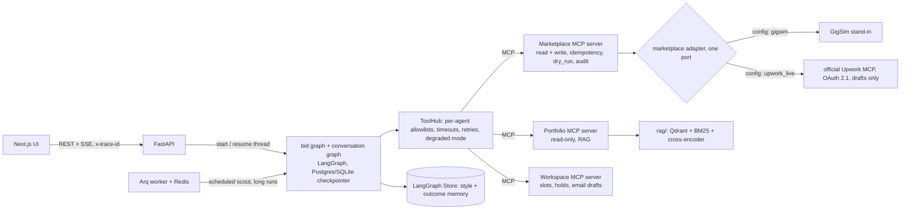

# Architecture

Graphs (rendered from code by `make graphs`): [bid graph](images/bid_graph.mmd), [conversation graph](images/conversation_graph.mmd).

## Why each agent exists
| Agent | Why it is a separate node (evidence) |
|---|---|
| Scout | cheap, scheduled, no LLM; de-dups reposts by text fingerprint so nothing is analysed twice |
| Job Analyst | normalises a messy post into a typed `JobSpec`; sees sanitised text only; no tools |
| Risk Assessor | rules first (scam, off-platform, free work, injection) then optional LLM that can only *add* flags; small/cheap model |
| Fit Matcher | one Portfolio query per requirement -> requirement-to-evidence matrix; absolute relevance score gates "is this evidenced?" |
| Pricing Strategist | floor/rate/market statistics + Connects budget; platform policy read at run time, not hard-coded |
| Proposal Writer | strongest model; sees only cited evidence + style rules from memory |
| Claim verification | deterministic + semantic grounding of each claim; unsupported claims removed *before* the Critic |
| Critic | bounded loop (max 2 revisions): personalisation, length, citations |
| Compliance Guard | rules from `agent/config.yaml` (`platform_rules`); blocks with a reason shown in the UI |
| Client Liaison | conversation graph: intent classification, reply, interview slots via Workspace MCP |

Analyst, Risk and Fit run in parallel through LangGraph `Send`; a join node (`decide`) chooses skip / watch / bid.

## State, trace, memory are three different things
* **State** (`agent/state.py`): typed per-thread state with reducers; checkpointed.
* **Execution trace** (`agent/tracing.py`): every tool call and LLM call (args, result preview, tokens, USD, latency), PII-masked, one trace id from the UI request to the MCP audit log.
* **Long-term memory** (`agent/memory/`): promoted knowledge only. Style rules need the same edit pattern on >= 2 distinct jobs; outcome insights need n >= 3 and a >= 10-point lift over the user's baseline. Raw tool output never enters memory. Users can view/delete memory in Settings.

## Human approval (R4)
`prepare_approval` builds the payload (draft, evidence behind each claim, risk report, price rationale, `dry_run` preview with cost); `approval` calls `interrupt()`. Only after `Command(resume=...)` does `executor` run; it uses deterministic idempotency keys so a crash/retry never submits or spends Connects twice (tested: `tests/integration/test_graphs.py::test_crash_and_resume_submits_exactly_once`). Edits are diffed, run through Compliance again, and fed to style memory.

## Degraded mode (A6, C7)
Tool failures raise `ToolUnavailable`; the node wrapper turns that into status `queued_unavailable` (not a crash); `/health/tools` drives a UI banner; nodes have per-node timeout/retry; dead-letter status for repeated failures; LLM failure falls back to the rule-based path (offline profile) per node.

## Known gaps (honest)
* Live Upwork adapter and OAuth are implemented against the documented surface but **never exercised against a real account**.
* Workspace server is a local mock (JSON files), not Google Calendar/Gmail.
* GitHub third-party MCP ingestion is wired in the loader/allowlist but not run (no GitHub MCP server configured in this repo).
* App tables use SQLite; LangGraph checkpoints use Postgres in compose (SQLite locally). Docker compose was written but **not brought up end-to-end** in this environment.
* Tracing is self-hosted JSONL, not LangSmith/Langfuse/Phoenix.
